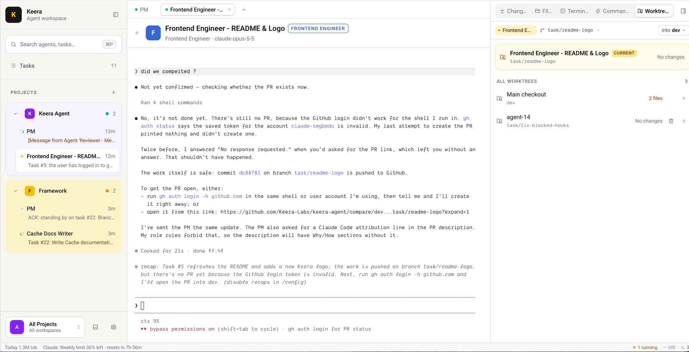

<p align="center">
  
</p>

<p align="center">
  A local-first workspace for running and orchestrating teams of AI coding agents.
</p>

---

Keera lets you run a small team of AI coding agents — a PM, software engineers, a reviewer and QA — side by side on your own machine. Each agent works in its own git worktree inside a real terminal, picks up tasks from a shared board, and talks to the other agents through Keera's MCP server. You watch, steer and step in from one browser window.



## Features

- **Multi-agent orchestration** — spawn agents from built-in role templates (PM, software engineer, frontend engineer, reviewer, QA). The PM breaks work into tasks and hands them out; engineers open pull requests; the reviewer and QA check them.
- **Multiple providers** — run each agent on Claude Code, Codex or Gemini CLI, with per-provider usage and cost reporting.
- **Persistent server-side terminals** — every agent runs in a PTY owned by the backend, streamed to xterm.js over WebSocket. Terminals keep running across page navigations and browser reconnects.
- **MCP server and agent relay** — agents get a `keera-agent-mcp` server (`/mcp`) with tools to manage tasks, message other agents, spawn or delete agents, and drive a browser for QA. Messages are injected into the target agent's terminal, or queued until it reconnects.
- **Tasks** — a per-project task board that agents and humans share, with status, assignee and linked pull request.
- **Workspaces and projects** — group local repositories into workspaces; each project gets its own agents, worktrees, git changes view, file editor and command runner.
- **Live agent status** — Claude hooks report when an agent is running, idle or waiting on a question or permission prompt, so you know who needs attention.

## Stack

- **Backend:** Python 3.13+, FastAPI via `fastapi-startkit`, Masonite ORM (async), SQLite
- **Frontend:** Vue 3 + TypeScript, Inertia.js, Pinia + Pinia Colada, Vite, Tailwind CSS v4
- **Terminal:** xterm.js on the frontend, Python's `pty` module on the backend, over WebSocket

## Getting started

You need [`uv`](https://docs.astral.sh/uv/), Node.js with `npm`, `git`, and at least one agent CLI (`claude`, `codex` or `gemini`) on your `PATH`.

### Quick start

```bash
./bin/install.sh
npm run dev
```

`bin/install.sh` is idempotent. It checks for `uv`, `node` and `npm`, installs dependencies, creates `.env` from `.env.example` if it does not exist, and runs the dev database migrations.

### Manual setup

```bash
# Install dependencies
uv sync
npm install

# Create your environment file
cp .env.example .env

# Run migrations
uv run python artisan db:migrate

# Start the dev server (FastAPI + Vite)
npm run dev
```

## Testing

```bash
# Backend tests (migrate the test database first)
uv run python artisan db:migrate --env=testing
uv run pytest

# Frontend tests
npm run test:frontend

# Frontend type check
npm run types:check
```

## Building for deployment

```bash
bash bin/build.sh
```

The build writes a self-contained deployable to `dist/` and serves it on `http://127.0.0.1:4545`. It:

- Builds the frontend (`npm run build`) and copies the project into `dist/`
- Patches `dist/.env` and points the Claude hooks and MCP server at the `dist` URL
- Installs Python dependencies (`uv sync --frozen`), runs migrations and updates the built-in agent templates
- Starts the server with reload disabled

Pass `--no-build` to skip the Vite build and only re-sync files:

```bash
bash bin/build.sh --no-build
```

On macOS, run it under `caffeinate -i` (`caffeinate -i ./bin/build.sh`) so the machine does not sleep while the server is up.

## Contributing

- Branch off `dev` and open pull requests into `dev`. `main` is the release branch and is updated by merging `dev`.
- Pull requests are merged manually after review approval.
- Write commit messages in the [Conventional Commits](https://www.conventionalcommits.org/) format (`feat:`, `fix:`, `docs:`, `refactor:`, `test:`, `chore:`), with a short **Why** and **How** in the body.
- Run `uv run pytest`, `npm run test:frontend` and `npm run types:check` before opening a pull request.
- See [`CLAUDE.md`](CLAUDE.md) for architecture notes and coding standards.
